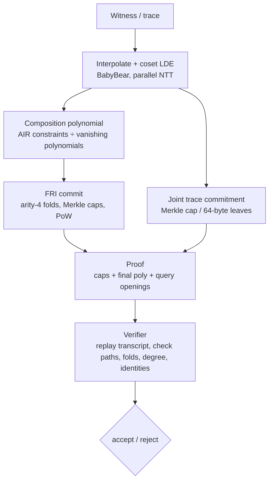

# z0p

[](https://github.com/FutureProofsTech/z0p/actions/workflows/ci.yml)
[](https://github.com/FutureProofsTech/z0p/releases)
[](LICENSE)
[](Cargo.toml)
[](Cargo.toml)
[](src/lib.rs)

> **Status: v0.3.0, unaudited research software.**
> The advertised ~100-bit figure is a conjectured query/proof-of-work
> schedule, not an end-to-end soundness theorem. See [SECURITY.md](SECURITY.md)
> and [AUDIT.md](AUDIT.md) before relying on any claim.

**z0p** is a from-scratch, zero-dependency zero-knowledge proving stack in
safe Rust: binary fields, the BabyBear prime field, a quartic extension field,
BLAKE3-256, Merkle trees, a parallel NTT, FRI, sumcheck, univariate and
multilinear polynomial commitments, LogUp lookups, STARKs, hash-folded IVC,
a minimal register-machine AIR, and zero-knowledge masking. Every layer is
implemented in this crate. `cargo tree` is one node.

No elliptic curves. No trusted setup. No `unsafe`. No runtime dependencies.
Hash-based, transparent, and in the plausibly post-quantum STARK family.

---

## Contents

- [At a glance](#at-a-glance)
- [Why z0p](#why-z0p)
- [Architecture](#architecture)
- [Feature status](#feature-status)
- [Quick start](#quick-start)
- [Usage](#usage)
- [Performance](#performance)
- [Soundness](#soundness)
- [Security model and evidence](#security-model-and-evidence)
- [Wire format and compatibility](#wire-format-and-compatibility)
- [Documentation map](#documentation-map)
- [Project structure](#project-structure)
- [Limitations](#limitations)
- [Roadmap](#roadmap)
- [Citation and license](#citation-and-license)

---

## At a glance

| Property | Value |
|---|---|
| Crate | `z0p` v0.3.0 |
| Language | Rust 2021, MSRV **1.74** |
| Runtime dependencies | **0** (`cargo tree` is one node) |
| `unsafe` | **forbidden** (`#![forbid(unsafe_code)]`) |
| Trusted setup | **none** |
| Hash | BLAKE3-256, implemented from the specification |
| Base field | BabyBear, `p = 2^31 - 2^27 + 1` |
| Challenge field | `Fp4 = Fp2[v]/(v^2-u)`, `Fp2 = Fp[u]/(u^2-11)` |
| Commitment | Merkle-committed Reed–Solomon / FRI |
| Proof systems | Fibonacci AIR, range, table, IVC, VM, LogUp, recursion fragment |
| PCS | FRI, UPCs, Gemini v1, BaseFold-style prototype |
| Zero knowledge | vanishing-multiple masking (`prove_zk`) |
| Wire format | canonical, versioned, `VERSION = 6` |
| License | GPL-3.0-only |

### Latest measured result

On the 16-core / 31 GB reference machine, release profile, `rustc 1.99.0`,
median of runs:

| Workload | Prove | Verify | Proof |
|---|---:|---:|---:|
| AIR Fibonacci, **1,048,576 steps**, production schedule | **1.734 s** | **1.13 ms** | **203,553 B** |
| AIR Fibonacci, 65,536 steps | 115.49 ms | 0.90 ms | 141,641 B |
| AIR Fibonacci, 1,024 steps | 37.05 ms | 0.48 ms | 68,573 B |
| FRI polynomial, 1,024 coefficients | 21.50 ms | 0.31 ms | 43,174 B |

The 1M-step row is **1.653 µs/step** (~**604,872 steps/s**) and a
**198.8 KiB** proof. Verification is essentially independent of trace size
because FRI domain points are derived on demand instead of materializing the
`O(lde_len)` layer stack. Full methodology and all 24 rows:
[docs/benchmarks.md](docs/benchmarks.md).

---

## Why z0p

Most practical zero-knowledge stacks ask users to trust a large surface:
pairing-friendly curves, multi-party setup ceremonies, deep dependency trees,
and protocol behavior that is described in papers but not reproducible from
the code. z0p takes the opposite constraint set:

1. **From zero.** Fields, hash, Merkle trees, NTT, FRI, sumcheck, AIRs, and
   lookups are owned by this crate. There is no third-party cryptography to
   audit transitively.
2. **Transparent and hash-based.** Security reduces to BLAKE3-256,
   Reed–Solomon proximity testing, and Fiat–Shamir. No curves, no pairings,
   no trusted setup, no quantum-vulnerable group assumptions.
3. **Safe by construction.** `#![forbid(unsafe_code)]`; fallible public APIs;
   canonical, fail-closed decoding; hostile parameters re-validated at every
   entry point.
4. **Quantified, not hand-waved.** Query and proof-of-work budgets are stated
   explicitly. The production recipe uses rate `1/16`, 40 queries, and
   20-bit grinding for a **conjectured ~100-bit query/PoW schedule**.
5. **Evidence alongside claims.** 277 library tests, three adversarial suites,
   exhaustive decoder fuzzing, byte-exact proof-size assertions, and a pinned
   benchmark regression gate run in CI.
6. **Auditable engineering.** One crate, one wire format, one gate command:
   `python3 tools/check.py`.

### What it is not

z0p is **not** an audited production system, a general zkVM, a circuit
compiler, or a private-table lookup protocol. The ~100-bit figure is a
query/PoW sizing, not a theorem. `lookup` and `sumcheck` expose tables in
clear; `lookup_pcs` hides columns from the wire but is not zero-knowledge;
`basefold`, `lookup_pcs`, `gemini`, and `vm` are experimental. See
[Limitations](#limitations).

---

## Architecture



The stack is deliberately layered:

| Layer | Modules | Responsibility |
|---|---|---|
| Algebra | `gf2`, `babybear`, `ext4` | Binary word fields, NTT-friendly prime field, quartic challenge field |
| Hashing | `hash`, `merkle` | BLAKE3-256, domain separation, capped Merkle trees, index-bound paths |
| Fiat–Shamir | `transcript`, `rng` | Streaming transcript, challenges, grinding, ChaCha20 CSPRNG |
| Polynomial core | `ntt`, `mle`, `sumcheck`, `fri` | Coset NTT, multilinear tables, sumcheck, FRI |
| Commitments | `upcs`, `gemini`, `basefold` | Univariate openings, multilinear PCS prototypes |
| Lookups | `lookup`, `lookup_pcs` | LogUp in clear and committed-input LogUp |
| Statements | `air`, `range`, `table`, `fold`, `vm`, `recursion` | STARKs, IVC, execution, recursion fragment |
| Privacy | `blind` | Vanishing-multiple zero-knowledge masking |
| Wire format | `codec` | Canonical versioned encoding, fail-closed decoding |
| Parallelism | `par` | Deterministic `std::thread` data parallelism |

### Design invariants

- **Rate gate on both sides.** `degree_bound + 1 <= lde_len / 2` at prove
  and verify.
- **Transcript binding.** Dimensions, commitments, public inputs, and
  proof-of-work nonces are absorbed before the challenges that depend on
  them.
- **Authenticated next rows.** AIR and IVC next-row values are the same
  committed columns opened at the `omega`-shifted LDE index, not an
  independent witness.
- **Committed leaves.** FRI quads and AIR trace leaves are hashed from the
  exact revealed bytes; Merkle path direction bits are bound to the claimed
  index.
- **Fail-closed decoding.** Canonical fields, bounded counts, no trailing
  bytes, no allocation before limits are checked.
- **No `unsafe`, no dependencies.** Enforced by the manifest, crate
  attribute, CI, and `cargo tree`.

---

## Feature status

| Component | Status | Notes |
|---|---|---|
| `babybear`, `ext4`, `gf2` | Stable core | Canonical arithmetic, inverses, tower laws |
| `hash`, `merkle`, `codec`, `transcript` | Stable core | KATs, caps, canonical wire format, streaming FS |
| `ntt`, `mle`, `sumcheck`, `fri` | Stable core | FRI production path, rate gate, final-degree check |
| `air`, `range`, `table`, `fold` | Working STARKs | Plain and masked variants where documented |
| `vm` | Experimental | Two-register straight-line program; not a zkVM |
| `lookup` | Working prototype | In-clear witness/table; sound but not hiding |
| `lookup_pcs` | Experimental | Committed-input LogUp; not zero-knowledge |
| `upcs`, `gemini` | Working prototypes | Transparent, non-hiding point/multilinear openings |
| `basefold` | Experimental prototype | Compact multilinear PCS; not wired into AIR |
| `recursion` | Fragment | Re-checks one FRI fold chain; not self-proving |
| `blind`, `rng` | Working | Query-response hiding; ChaCha20 CSPRNG |

---

## Quick start

`z0p` is not published on crates.io. Use it as a path or git dependency, or
build this repository directly.

```sh
git clone https://github.com/FutureProofsTech/z0p.git
cd z0p

cargo build --release
cargo test                 # debug: library + security/red-team/hardening
cargo test --release       # optimized: same suites
cargo bench                # 24 speed/size rows, release profile
python3 tools/check.py     # full gate: fmt, links, rustdoc, clippy, tests, bench
```

The default build is stable Rust 1.74+. The optional SIMD hash path needs a
nightly toolchain:

```sh
RUSTC_BOOTSTRAP=1 cargo test --features simd
RUSTC_BOOTSTRAP=1 cargo bench --features simd
```

`BENCH_ROW=substr` runs a subset, for example:

```sh
BENCH_ROW=N1048576 cargo bench
BENCH_ROW='air prod' cargo bench
```

---

## Usage

### Fibonacci AIR

```rust
use z0p::{air, babybear::Field, transcript::Transcript};

let steps = 64;
let (_, trace_b) = air::build_trace(Field::ONE, Field::ONE, steps);
let params = air::Params::new(
    steps,
    8,                    // blowup
    12,                   // FRI queries
    8,                    // final layer size
    Field::ONE,           // a0
    Field::ONE,           // b0
    trace_b[steps - 1],   // claimed B[N-1]
).expect("valid params");

let mut prover = Transcript::new(b"my-app/fib");
let proof = air::prove(params, &mut prover).expect("prove");

let mut verifier = Transcript::new(b"my-app/fib");
air::verify(params, &proof, &mut verifier).expect("verify");
```

### Production query/PoW schedule

```rust
use z0p::{air, babybear::Field};

let (_, trace_b) = air::build_trace(Field::ONE, Field::ONE, 1 << 20);
let b_last = trace_b[(1 << 20) - 1];

let params = air::Params::for_security(
    1 << 20,
    Field::ONE,
    Field::ONE,
    b_last,
    100,                  // conjectured query/PoW target
).expect("valid params");
```

`for_security` selects blowup 16, sizes queries and grinding through
`fri::tune_strength`, and chooses a size-optimal final layer and Merkle cap
height through `fri::tune_shape`. It is a query/PoW recipe, not a proof of
end-to-end soundness.

### Range and table checks

```rust
use z0p::{babybear::Field, range, table, transcript::Transcript};

let rp = range::Params::new(
    32,        // rows
    8,         // bit width, 1..=24
    4,         // blowup
    8,         // queries
    8,         // final size
    Field::new(42),
).expect("range params");
let mut t = Transcript::new(b"my-app/range");
let rproof = range::prove(rp, &mut t).expect("range prove");
let mut t = Transcript::new(b"my-app/range");
range::verify(rp, &rproof, &mut t).expect("range verify");

let table_values: Vec<Field> = [10, 20, 30, 40].iter().map(|v| Field::new(*v)).collect();
let tp = table::Params::new(8, 8, 8, 4, Field::new(30)).expect("table params");
let mut t = Transcript::new(b"my-app/table");
let tproof = table::prove(tp, &table_values, &mut t).expect("table prove");
let mut t = Transcript::new(b"my-app/table");
table::verify(tp, &table_values, &tproof, &mut t).expect("table verify");
```

### Program execution (`vm`)

```rust
use z0p::{babybear::Field, transcript::Transcript, vm};

let program = vec![
    vm::Op::SetA(Field::new(2)),
    vm::Op::SetB(Field::new(3)),
    vm::Op::Add,
    vm::Op::Mul,
    vm::Op::Swap,
    vm::Op::Halt,
];
let params = vm::Params::new(
    16, 8, 2, 2,
    program,
    Field::new(3),
    Field::new(15),
).expect("vm params");

let mut t = Transcript::new(b"my-app/vm");
let proof = vm::prove(&params, Field::new(10), Field::new(20), &mut t)
    .expect("vm prove");
let mut t = Transcript::new(b"my-app/vm");
vm::verify(&params, &proof, &mut t).expect("vm verify");
```

### Zero-knowledge variants

`air::prove_zk`, `range::prove_zk`, `table::prove_zk`, and `vm::prove_zk`
mask trace columns with random multiples of the trace-domain vanishing
polynomial. Verification is unchanged.

```rust
use z0p::{babybear::Field, rng::ChaCha20, transcript::Transcript, vm};

let program = vec![vm::Op::SetA(Field::new(2)), vm::Op::Halt];
let params = vm::Params::new(8, 8, 2, 8, program, Field::new(2), Field::new(4))
    .expect("vm params");
let mut rng = ChaCha20::new([7u8; 32], [3u8; 12]);
let mut t = Transcript::new(b"my-app/vm-zk");

// Two revealed rows per query (current and shifted); use at least 2 * queries.
let proof = vm::prove_zk(&params, Field::new(9), Field::new(4), 8, &mut rng, &mut t)
    .expect("vm zk prove");
let mut t = Transcript::new(b"my-app/vm-zk");
vm::verify(&params, &proof, &mut t).expect("vm zk verify");
```

Masking budgets are protocol-specific:

| Protocol | Revealed values per column | Minimum `n_rand` |
|---|---|---|
| `range`, `table` | one point per query | `num_queries` |
| `vm` | current and shifted rows | `2 * num_queries` |
| `air` | eight-row leaf and shifted leaf | `16 * num_queries` |

### FRI directly

```rust
use z0p::{babybear::Field, fri, transcript::Transcript};

let coeffs: Vec<Field> = (0..1024).map(|i| Field::new(i + 1)).collect();
let params = fri::Params::for_security(1024, 100).expect("fri params");
let mut prover = Transcript::new(b"my-app/fri");
let state = fri::commit(&coeffs, params, &mut prover).expect("commit");
let commitment = fri::public_commitment(&state);
let (proof, _) = fri::open(&state, &mut prover).expect("open");

let mut verifier = Transcript::new(b"my-app/fri");
fri::verify(&commitment, &proof, params, &mut verifier).expect("verify");
```

### Multilinear BaseFold opening

```rust
use z0p::{babybear::Field, basefold, ext4::Ext4, transcript::Transcript};

let coeffs: Vec<Field> = (0..1024).map(|i| Field::new(i + 3)).collect();
let state = basefold::commit(&coeffs, 16).expect("commit");
let commitment = state.commitment().clone();
let point = vec![Ext4::ZERO; 10];
let value = Ext4::from_base(coeffs[0]); // f(0,..,0) for monomial coefficients
let params = basefold::Params::for_security(1024, 100).expect("params");

let mut prover = Transcript::new(b"my-app/basefold");
let proof = basefold::open(&state, &point, value, params, &mut prover)
    .expect("open");
let mut verifier = Transcript::new(b"my-app/basefold");
basefold::verify(&commitment, &point, value, &proof, params, &mut verifier)
    .expect("verify");
```

The BaseFold module is an experimental prototype, not an audited production
commitment.

---

## Performance

**Method.** `benches/speed_size.rs`, release profile, median of runs after one
warm-up, 16 cores / 31 GB, `rustc 1.99.0`, measured **2026-11-05**. Every row
verifies its proof outside the timed region, and byte counters assert
`to_bytes().len()` exactly. Proof sizes are deterministic; times are
hardware- and load-dependent. The regression gate allows 3× timing drift and
requires byte-exact sizes.

### Production AIR / FRI

| Row | Prove | Verify | Proof |
|---|---:|---:|---:|
| FRI polynomial, 256 coefficients (`B16 Q40 G20 C4 F16`) | 10.59 ms | 0.25 ms | 29,378 B |
| AIR Fibonacci, 64 steps | 11.99 ms | 0.27 ms | 33,061 B |
| FRI polynomial, 1,024 coefficients | 21.50 ms | 0.31 ms | 43,174 B |
| AIR Fibonacci, 1,024 steps | 37.05 ms | 0.48 ms | 68,573 B |
| AIR Fibonacci, 8,192 steps | 49.81 ms | 0.59 ms | 101,233 B |
| AIR Fibonacci, 65,536 steps | 115.49 ms | 0.90 ms | 141,641 B |
| **AIR Fibonacci, 1,048,576 steps** | **1,733.55 ms** | **1.13 ms** | **203,553 B** |

The 1M-step row is **1.653 µs/step** and **604,872 steps/s**. Proof size
grows logarithmically; verification stays in the low-millisecond range from
1,024 to 1,048,576 steps. On the optional nightly SIMD hash path, a
representative run of the same row measured **1,693.58 ms** (~2.3% faster);
the default scalar path remains the supported stable build.

### Multilinear PCS, 1,024 coefficients, `B16 Q40 G20`

| Construction | Prove | Verify | Commitment + proof |
|---|---:|---:|---:|
| BaseFold-style prototype | 22.65 ms | 0.88 ms | 127,658 B |
| BaseFold-style, cap height 4 | 22.91 ms | 0.63 ms | 80,018 B |
| Gemini v1 (one multi-point opening per layer) | 317.96 ms | 7.36 ms | 887,872 B |

Cap height 4 reduces the BaseFold proof by **37.3%** (127,658 → 80,018 B).
The BaseFold rows are experimental and not wired into the AIR/STARK stack.

### Committed lookup and execution

| Workload | Prove | Verify | Size |
|---|---:|---:|---:|
| `lookup_pcs`, 1,024-in-1,024, `B16 Q40 G20 C4` | 273.01 ms | 5.77 ms | 642,443 B |
| `vm`, 64-step, `B16 Q12 C2` | 0.69 ms | 0.18 ms | 14,933 B |

`lookup_pcs` commits witness, table, multiplicities, and both quotient
columns, then carries eight BaseFold openings. It is committed-input but not
zero-knowledge. The `vm` row is the plain path; `vm::prove_zk` is not
benchmarked.

### Fast bench shapes (~18 conjectured query bits)

| Workload | Prove | Verify | Proof |
|---|---:|---:|---:|
| FRI polynomial, 256 coefficients | 0.15 ms | 0.08 ms | 11,522 B |
| AIR Fibonacci, 64 steps | 0.17 ms | 0.11 ms | 15,465 B |
| Range, 16-bit | 0.10 ms | 0.07 ms | 5,217 B |
| Table, 4 entries | 0.04 ms | 0.04 ms | 4,673 B |
| Lookup, 64-in-16 | 0.19 ms | 0.09 ms | 2,897 B |
| Fold, 4×8 Fibonacci | 0.19 ms | 0.19 ms | 16,845 B |
| AIR Fibonacci, 1,024 steps | 2.01 ms | 0.20 ms | 28,257 B |

### Primitives

| Primitive | Measured |
|---|---:|
| BLAKE3, 1 MiB | 1.17 ms (856.5 MB/s) |
| BabyBear multiplication | 6.59 ms / 1M ops (151.8 Mops/s) |
| GF(2^64) multiplication | 272.84 ms / 1M ops (3.7 Mops/s) |
| NTT forward, 2^14 | 0.32 ms |
| Merkle tree, 65,536 leaves | 3.24 ms |

---

## Soundness

The following table is **conjectured** under the Johnson-radius FRI
heuristic and Fiat–Shamir in the (quantum) random-oracle model. It counts
query sampling and proof-of-work only; it is not an end-to-end soundness
proof.

| Shape | Rate | Queries | Grinding | Conjectured query + PoW |
|---|---:|---:|---:|---:|
| Bench (fast, weak) | 1/8 | 12 | 0 bits | ~18 bits |
| Production | 1/16 | 40 | 20 bits | ~100 bits (80 + 20) |

**Challenge field.** FRI folds, STARK composition batches, `upcs`/Gemini
points and betas, sumcheck rounds, and lookup's rational-identity challenge
draw from the quartic extension `Fp4` over BabyBear. A degree-`d` algebraic
identity collides with probability roughly `d / p^4` per challenge, giving
about **124 bits** of per-challenge algebraic entropy. This removes the
former ~31-bit algebraic ceiling but does not turn the query/PoW schedule
into a theorem.

**Parameter sizing.** `Params::for_security(..., target_bits)` uses blowup
16 and splits the target between queries and grinding. Production callers
should use it rather than the small bench defaults. The FRI verifier enforces
an absolute rate below `1/2`, requires `final_size >= 2` (a one-point final
layer would make the degree check vacuous), caps `final_size` at 1024, and
requires a non-vacuous residual bound. Merkle cap height is capped at 8.

**What is not claimed.** No external audit, no end-to-end theorem, no
general-purpose circuit compiler, no zkVM, no private-table lookup, and no
side-channel resistance against the host OS, compiler, or CPU. See
[SECURITY.md](SECURITY.md) and [AUDIT.md](AUDIT.md).

---

## Security model and evidence

### Threat model

The verifier is the adversary-facing surface. Untrusted inputs are proof
bytes, commitments, public parameters, and public tables/claims. Hostile
inputs must fail closed with `Err`, never panic, and never force unbounded
allocation or work. Proof-of-work grinding is a prover-side cost; the
verifier only checks a nonce. `lookup` and `sumcheck` expose their tables in
clear; `lookup_pcs` hides columns from the wire but is not zero-knowledge.
The full threat model and out-of-scope items are in
[SECURITY.md](SECURITY.md#threat-model).

### Test matrix

| Suite | Tests | Evidence |
|---|---:|---|
| Library (`cargo test --lib`) | **277** | Arithmetic KATs, Horner cross-checks, parallel determinism, protocol roundtrips |
| `tests/security.rs` | **13** | 479 hostile attempts: FRI/trace/path/commitment tampering, PoW forgery, rate gates, byte fuzz |
| `tests/redteam.rs` | **10** | 37 targeted attacks + 500-input garbage storm: transplants, false statements, IVC surgery, transcript abuse |
| `tests/hardening.rs` | **11** | Hostile `Params`, exhaustive per-bit AIR decoder fuzz, 14,000 random mutations across seven encodings, RNG checks |
| Doc tests | **5** | Public examples |
| **Total** | **316** | Plus the coverage-guided `fuzz/decode` target |

Standing result on the current tree: **zero acceptances, zero panics** for
the adversarial suites — **1,016 targeted hostile trials** (479 security +
537 red-team) plus exhaustive decoder fuzzing. `python3 tools/check.py`
runs fmt, Markdown links, rustdoc, pedantic clippy, debug tests, release
tests, and the benchmark regression gate.

### Closed findings worth knowing

The adversarial suites and internal review have already closed real issues.
The most important are documented in
[docs/security-tests.md](docs/security-tests.md):

- **Merkle paths did not bind direction bits to the claimed index**, allowing
  a valid opening to be replayed at another in-range position. Fixed in
  `merkle`, FRI, and BaseFold path walks.
- **A one-point FRI final layer made the final degree check vacuous**, and the
  tiny-table `for_security` tuner could select it. Every `Params` now requires
  `final_size >= 2`, and FRI rejects vacuous residual bounds.
- **Fold-free FRI (`final_size == lde_len`) had no query openings** and did not
  bind `final_poly` to the commitment. Commit and verify now reject it.
- **`lookup_pcs` read-checks used uncommitted `beta + value` MLEs.** They now
  use the committed witness/table/multiplicity columns directly.
- **VM masked proving under-declared its quadratic `Mul` quotient degree.**
  The prover now declares `2 * (n + n_rand - 1)`.
- **ZK mask budgets undercounted revealed leaf/row values.** AIR requires
  `16 * num_queries`; VM requires `2 * num_queries`.
- **Batched BaseFold openings used the equality table for a monomial
  commitment.** They now use the multilinear basis table.

### Fuzzing

```sh
cargo install cargo-fuzz   # once
cargo +nightly fuzz run decode
cargo +nightly fuzz run decode -- -runs=100000 -max_len=8192
```

The target covers every public decoder and requires a canonical
`to_bytes`/`from_bytes` round-trip for every successful decode. See
[fuzz/README.md](fuzz/README.md).

---

## Wire format and compatibility

All proof types use a canonical versioned encoding, `VERSION = 6`:

- little-endian integers; `u32` counts; `u64` dimensions and indices;
- base-field elements are 4 canonical bytes (`< p`, otherwise rejected);
- extension elements are 16 canonical bytes (four checked coordinates);
- digests are 32 bytes; Merkle directions are `0`/`1` only;
- trailing bytes, truncation, non-canonical fields, and oversized counts are
  rejected before allocation.

Hard decoder limits:

| Limit | Value |
|---|---:|
| `MAX_QUERIES` | 2^20 (1,048,576) |
| `MAX_FOLDS` | 64 |
| `MAX_PATH_STEPS` | 128 |
| `MAX_CAP_DIGESTS` | 256 |
| `MAX_ELEMS` | 2^27 (134,217,728) |
| `MAX_STEPS` (IVC) | 2^20 (1,048,576) |
| FRI `MAX_FINAL_SIZE` | 1024 |
| Maximum Merkle cap height | 8 |
| BaseFold `MAX_BATCH` | 1024 |
| BaseFold `MAX_VARS` | 16 |
| Gemini `MAX_VARS` | 20 |
| UPCs `MAX_POINTS` | 16 |
| VM `MAX_PROGRAM` | 2^20 |

Proof sizes are asserted byte-for-byte by the benchmark harness and pinned
in `tools/baseline.json`. A wire-format change must bump `VERSION` and update
the size assertions; see [CONTRIBUTING.md](CONTRIBUTING.md).

---

## Documentation map

| Document | Purpose |
|---|---|
| [AUDIT.md](AUDIT.md) | Auditor entry point: scope, invariants, reproduction, evidence |
| [docs/whitepaper.md](docs/whitepaper.md) | High-level academic overview, design, evaluation, roadmap |
| [docs/yellowpaper.md](docs/yellowpaper.md) | Formal specification: mathematics, protocols, encodings, parameters |
| [docs/benchmarks.md](docs/benchmarks.md) | Full measured tables, methodology, SIMD notes |
| [docs/security-tests.md](docs/security-tests.md) | Attack-suite results and closed findings |
| [docs/red-team.md](docs/red-team.md) | Cross-proof, false-statement, IVC, garbage-storm results |
| [docs/unit-tests.md](docs/unit-tests.md) | Per-module test breakdown |
| [papers/z0p-whitepaper.tex](papers/z0p-whitepaper.tex) | White-paper LaTeX source |
| [papers/z0p-whitepaper.pdf](papers/z0p-whitepaper.pdf) | Compiled white paper (11 pages) |
| [papers/z0p-yellowpaper.tex](papers/z0p-yellowpaper.tex) | Yellow-paper LaTeX source |
| [papers/z0p-yellowpaper.pdf](papers/z0p-yellowpaper.pdf) | Compiled formal specification (16 pages) |
| [papers/z0p-eprint.tex](papers/z0p-eprint.tex) | Combined long-form technical report source |
| [papers/z0p-eprint.pdf](papers/z0p-eprint.pdf) | Combined technical report (19 pages) |
| [SECURITY.md](SECURITY.md) | Threat model, reporting, disclosure policy |
| [CONTRIBUTING.md](CONTRIBUTING.md) | Ground rules, gates, wire-format policy |
| [RELEASING.md](RELEASING.md) | Immutable tags and release checklist |
| [CHANGELOG.md](CHANGELOG.md) | Release history and security fixes |

---

## Project structure

```text
src/
  gf2.rs        binary fields GF(2^8)/GF(2^64)/GF(2^128)
  babybear.rs   NTT-friendly prime field (Barrett mul, batch inversion)
  ext4.rs       quartic extension Fp4 over BabyBear
  hash.rs       BLAKE3-256 from spec (KAT-validated)
  transcript.rs streaming Fiat-Shamir transcript + proof-of-work grinding
  merkle.rs     domain-separated trees, caps, index-bound paths
  ntt.rs        parallel Cooley-Tukey NTT, Reed-Solomon extension
  par.rs        deterministic std::thread data parallelism
  fri.rs        FRI polynomial commitment (commit / open / verify)
  mle.rs        multilinear polynomials
  sumcheck.rs   sumcheck over MLE products
  upcs.rs       FRI-backed univariate commitments + point openings
  gemini.rs     multilinear commitments (Gemini fold chains)
  basefold.rs   compact multilinear PCS prototype (sumcheck + FRI folds)
  lookup.rs     LogUp-style table membership via sumcheck
  lookup_pcs.rs committed LogUp over compact BaseFold openings
  vm.rs         two-register program-execution AIR (+ ZK)
  air.rs        Fibonacci AIR/STARK (+ ZK)
  range.rs      range-check AIR (+ ZK)
  recursion.rs  one-query FRI fold-chain AIR (recursion fragment)
  table.rs      table-membership AIR (+ ZK)
  fold.rs       hash-folded IVC accumulation, one batched FRI
  blind.rs      vanishing-multiple ZK masking
  rng.rs        ChaCha20 CSPRNG + OS seeding
  codec.rs      versioned canonical serialization (fail-closed decoder)
tests/
  security.rs   adversarial suite (tamper, fuzz, forgery)
  redteam.rs    cross-proof, false-statement, IVC, garbage vectors
  hardening.rs  hostile Params, decoder fuzz, invariant + RNG checks
benches/
  speed_size.rs 24-row speed + wire-exact size harness
tools/
  check.py      full gate + baseline.json regression table
  check_links.py    relative Markdown link checker
  release_check.py  version/changelog/tag consistency check
fuzz/
  fuzz_targets/decode.rs  coverage-guided decoder round-trip target
  README.md               local fuzzing instructions and scope
.github/
  workflows/ci.yml  fmt, links, tests, MSRV, rustdoc, release-tag gates
docs/
  whitepaper.md      design, evaluation, roadmap
  yellowpaper.md     formal specification
  benchmarks.md      measured numbers + methodology
  security-tests.md  attack-suite results
  red-team.md        red-team results
  unit-tests.md      unit-test breakdown
papers/
  z0p-whitepaper.tex   white-paper LaTeX source
  z0p-whitepaper.pdf   compiled white paper
  z0p-yellowpaper.tex  formal-specification LaTeX source
  z0p-yellowpaper.pdf  compiled yellow paper
  z0p-eprint.tex       combined technical report source
  z0p-eprint.pdf       combined technical report PDF
AUDIT.md         auditor entry point
CITATION.cff     software citation metadata
SECURITY.md      threat model + vulnerability reporting
CONTRIBUTING.md  ground rules, gates, wire-format policy
RELEASING.md     immutable tag and release checklist
CHANGELOG.md     release history
```

---

## Limitations

- **Unaudited.** No external audit; soundness figures are conjectured.
- **No general circuit compiler or zkVM.** The `vm` prototype is a
  two-register straight-line machine with public programs and no memory or
  control flow.
- **Not all paths are hiding.** `lookup`, `sumcheck`, `upcs`, `gemini`, and
  `basefold` are transparent/non-hiding. `lookup_pcs` hides columns from the
  wire but is not zero-knowledge; candidate inputs can be tested against its
  commitments.
- **Small-table table AIR.** `table` scales with the public table size; large
  private tables need committed sumcheck and a hiding PCS.
- **Experimental components.** `basefold`, `lookup_pcs`, `gemini`, `vm`, and
  `recursion` are prototypes, not audited production paths.
- **Side channels.** No claim of resistance to host OS, compiler, or CPU
  side channels; the crate forbids `unsafe` but is not a hardware token.
- **Bench defaults are weak.** Use `for_security` for production-sized query
  and grinding budgets.

---

## Roadmap

1. **External audit.** The evidence package — suites, gates, pinned sizes,
   versioned wire format — is ready for review.
2. **Hiding PCS and sumcheck.** Private tables and witness-independent
   multilinear openings.
3. **Batched BaseFold openings.** Replace `lookup_pcs`'s eight separate
   openings with the `open_multi` batch path.
4. **Self-proving recursion.** BLAKE3 path checks, final-degree check, and
   transcript derivation inside the recursion AIR.
5. **zkVM direction.** Control flow, memory, instruction privacy, and a
   general circuit compiler.
6. **SIMD and scheduling.** More portable-SIMD hash coverage and lower
   parallel scheduling overhead.

---

## Citation and license

If you use z0p in academic work, cite the software metadata in
[CITATION.cff](CITATION.cff):

```bibtex
@software{z0p,
  title  = {z0p: a zero-dependency transparent STARK stack in safe Rust},
  author = {Future Proofs Tech},
  year   = {2026},
  url    = {https://github.com/FutureProofsTech/z0p},
  note   = {Version 0.3.0, unaudited research software}
}
```

The white paper is [papers/z0p-whitepaper.pdf](papers/z0p-whitepaper.pdf).
The formal specification is [papers/z0p-yellowpaper.pdf](papers/z0p-yellowpaper.pdf)
(and its Markdown source [docs/yellowpaper.md](docs/yellowpaper.md)).
The combined technical report is [papers/z0p-eprint.pdf](papers/z0p-eprint.pdf).

**License:** GPL-3.0-only. See [LICENSE](LICENSE).

**Security reports:** do not open a public issue for suspected soundness,
zero-knowledge, or memory-safety bugs. Follow [SECURITY.md](SECURITY.md) and
email **futureproofs@proton.me**.
